# CET Manager

Aplicativo Android em Java e XML para a gestão de clientes e mensalidades da Conto eFootball Trading (CET).
Projeto acadêmico de Lucas Chaibub Amaral de Lemos Santos (matrícula 202510629).

- Documentação (Template Padrão, ABNT): [PDF](docs/CETM_LucasChaibub_Entrega7.pdf) · [DOCX editável](docs/CETM_LucasChaibub_Entrega7.docx)
- APK de depuração: [apk/CET-Manager-debug.apk](apk/CET-Manager-debug.apk)

## Entrega 7 — controle de mensalidades

| Requisito | Implementação |
|---|---|
| RF04 — Registrar pagamento | Competência (MM/AAAA), valor e data do pagamento, a partir dos detalhes do cliente |
| RF05 — Situação financeira | Mensalidade do mês atual (paga/pendente) e histórico de pagamentos nos detalhes |
| RF06 — Clientes com pendência | Botão **Mensalidades**: relatório do mês com pendentes, pagos e total recebido |
| RF02 — Consultar clientes | A lista mostra a situação da mensalidade do mês |

Regras desta etapa: competência entre 11/2020 e o mês atual; valor maior que zero e menor que R$ 100.000,00; data válida e não futura; um pagamento por competência para cada cliente. Pendente significa "sem pagamento registrado para a competência" — vencimento e inadimplência ainda não estão definidos.

Os dados continuam **somente em memória** (o banco de dados é a próxima etapa da disciplina). Autenticação, edição, situação cadastral e arquivamento ainda não foram implementados.

### Como demonstrar

1. Cadastre dois clientes fictícios (por exemplo, Joao Silva e Maria Souza).
2. Abra Joao Silva: a mensalidade do mês aparece como **Pendente**.
3. Toque em **Registrar pagamento** e salve sem valor: o app pede o valor.
4. Registre 150,00 para o mês anterior e depois para o mês atual.
5. Confira a situação **Paga** e o histórico; tente repetir a competência atual (é recusada).
6. Volte à lista e toque em **Mensalidades** para ver o relatório.

## Entrega 6 — cadastro e consulta de clientes

Cadastro com nome, e-mail e telefone (com validação e bloqueio de e-mail duplicado), lista, busca por nome/e-mail e detalhes.

## Executar

Abra a pasta no Android Studio, aguarde a sincronização do Gradle e execute o módulo **app** em um dispositivo Android 6.0 (API 23) ou superior. Pelo terminal, com JDK 17 ou 21 e o Android SDK configurados:

```powershell
.\gradlew.bat testDebugUnitTest lintDebug assembleDebug
```

Configuração: Java 17, compileSdk 35, targetSdk 34, minSdk 23, Android Gradle Plugin 8.7.3 e Gradle 8.9.

## Prints

Capturas reais do app no emulador Android 6.0 (API 23).

Entrega 7:

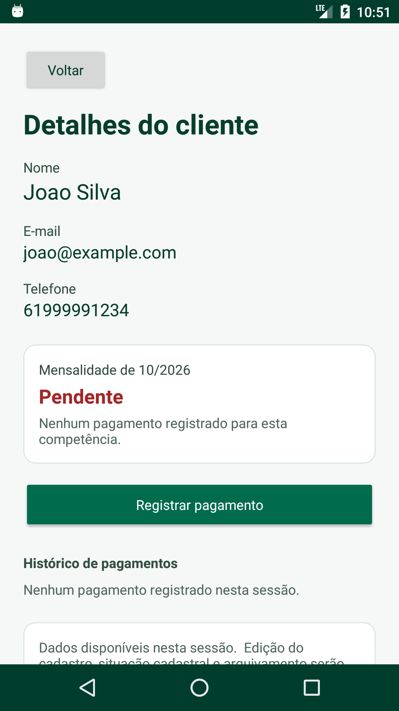

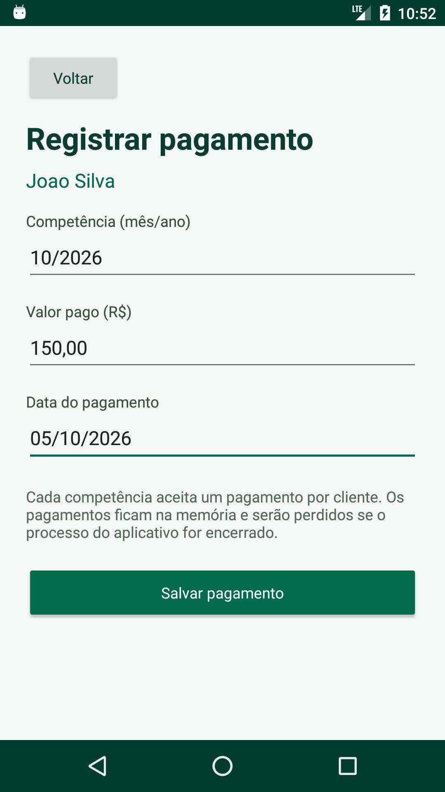

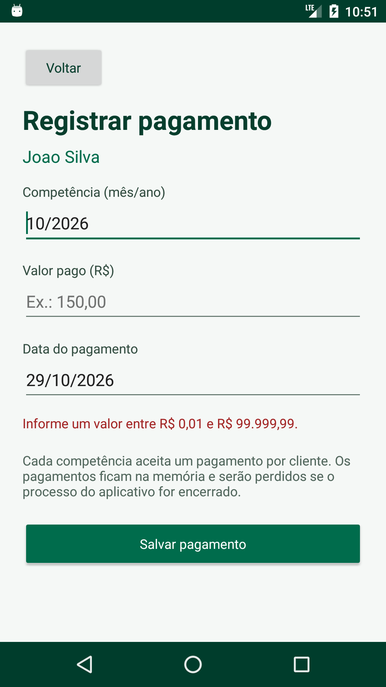

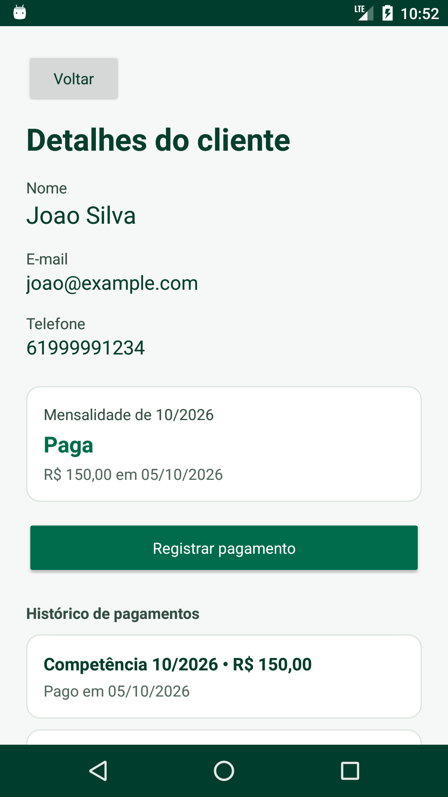

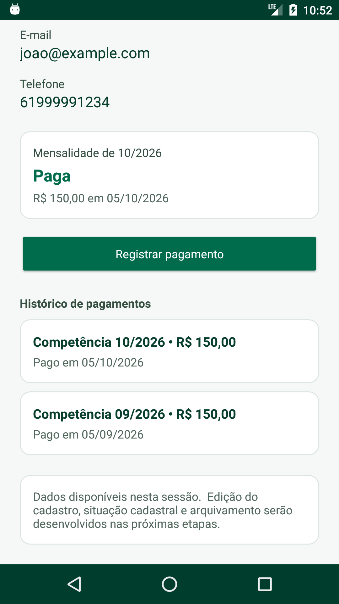

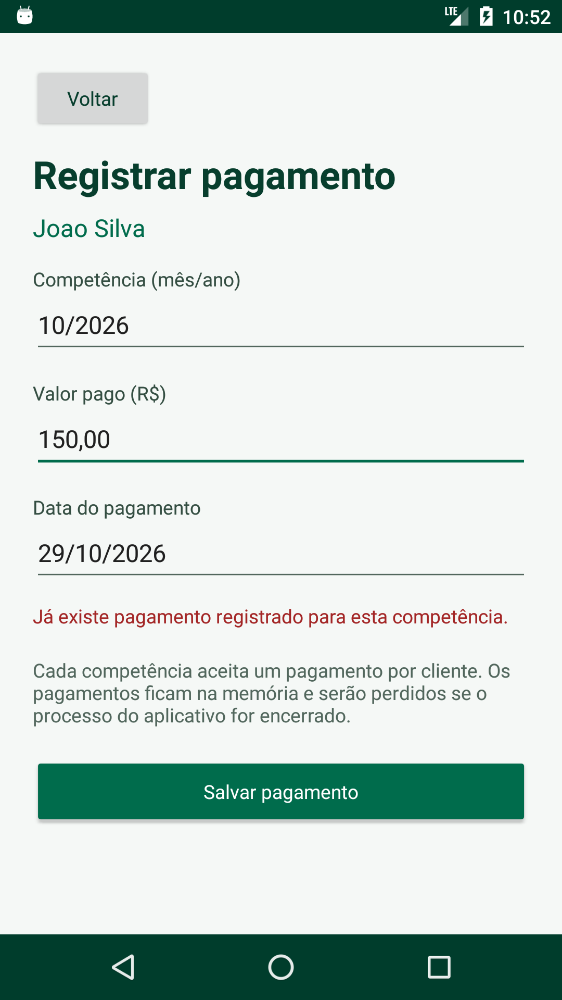

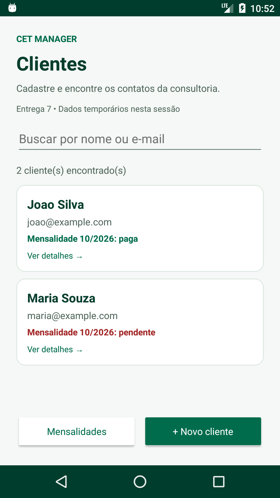

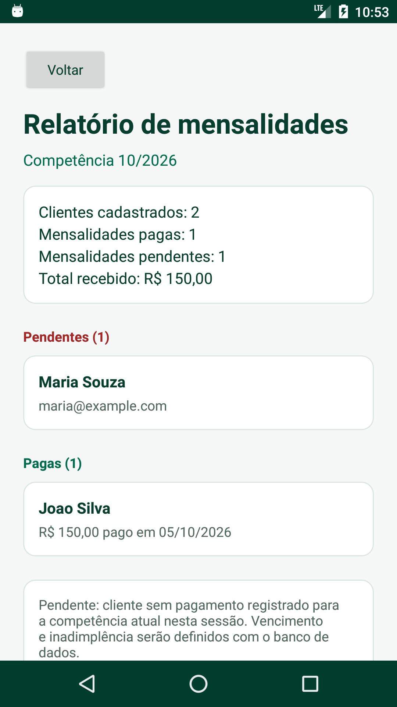

Entrega 6:

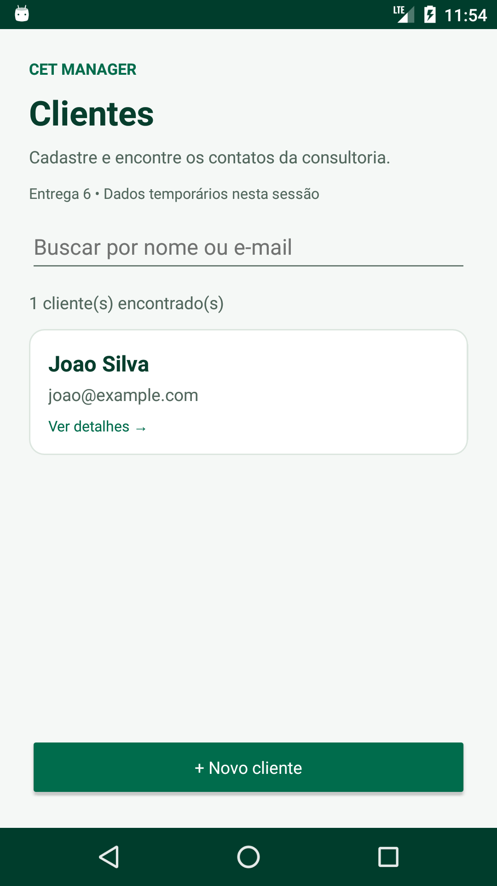

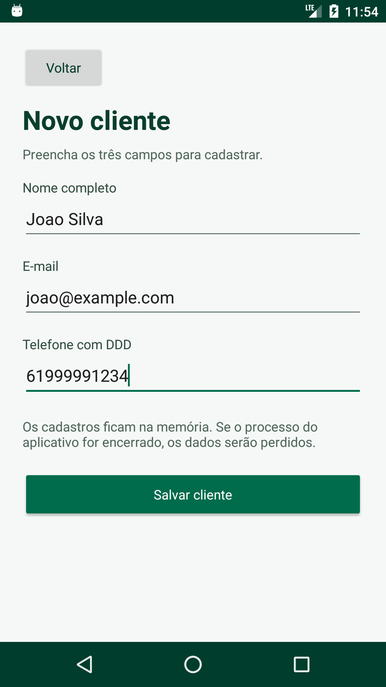

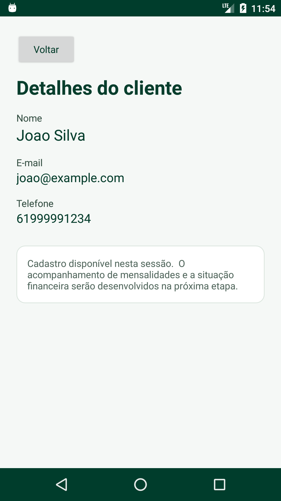

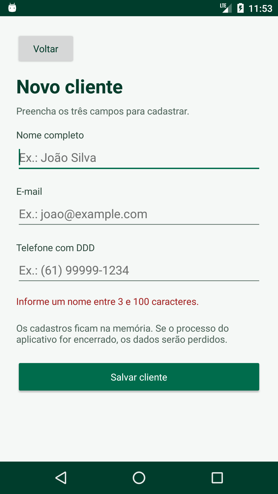

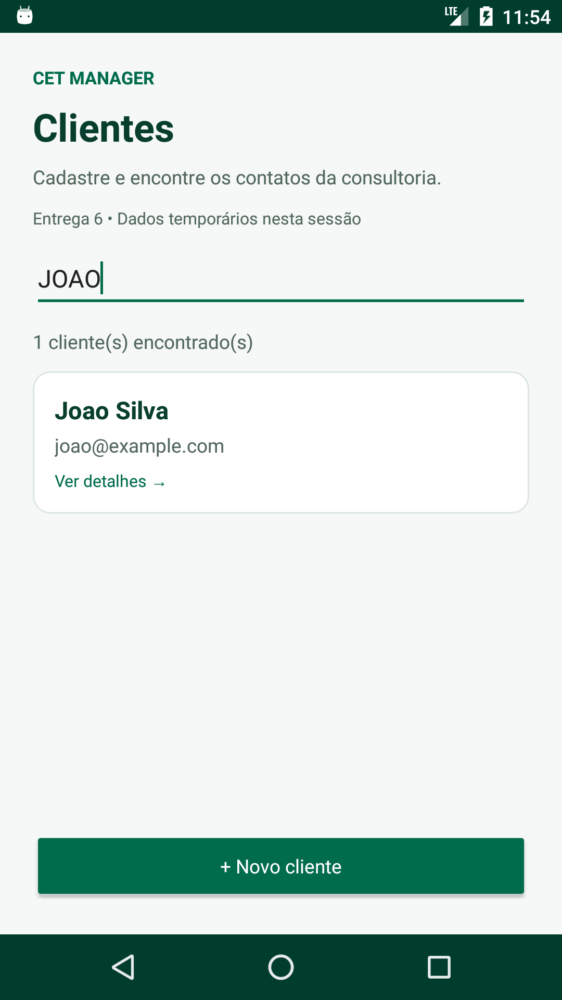

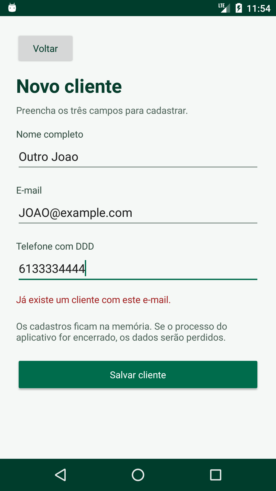
